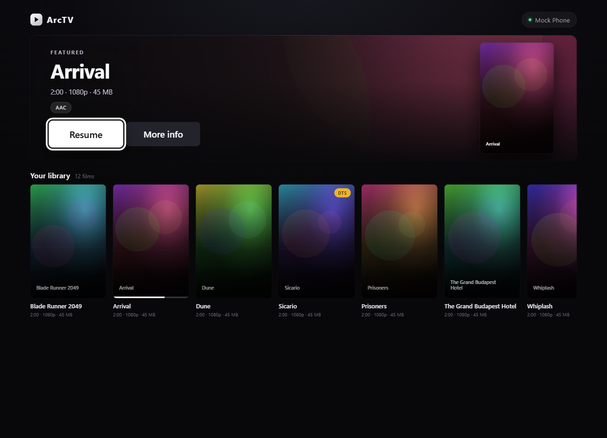
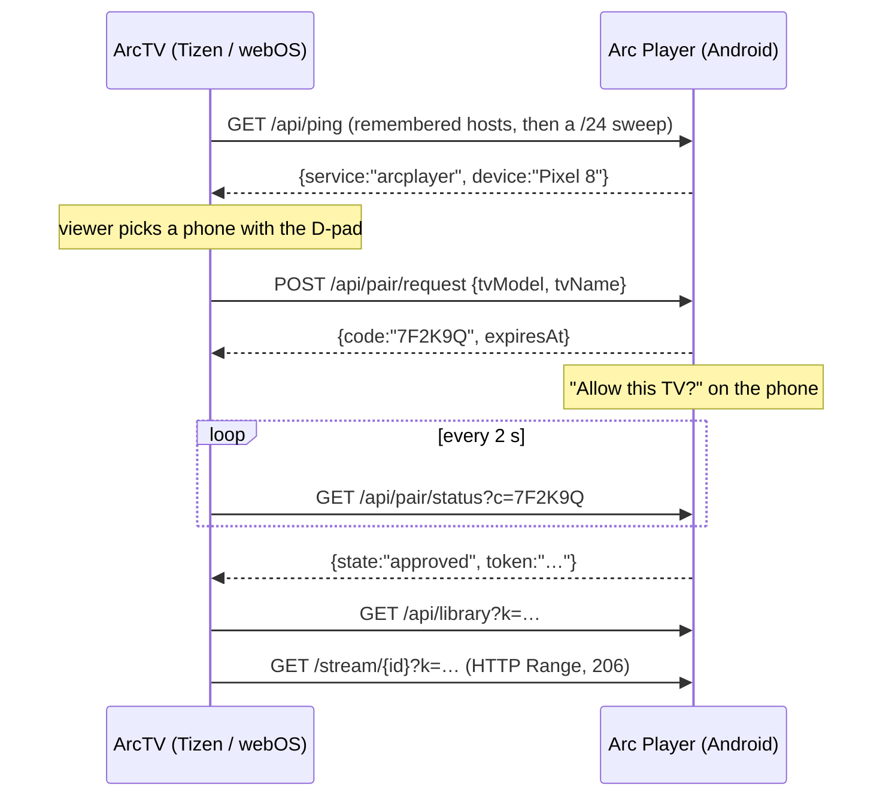
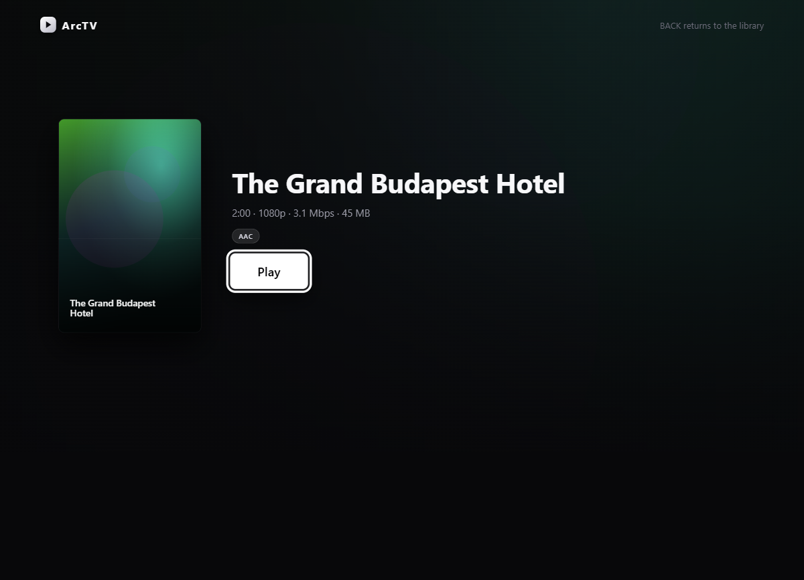
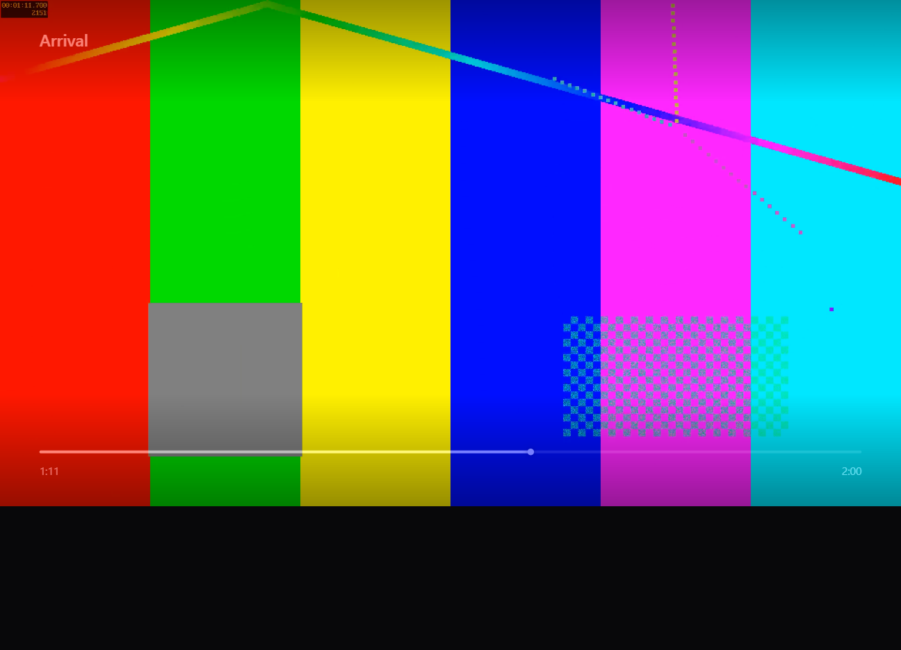

<div align="center">

# ArcTV

**Your Arc Player library, on the television.**

Three clients for one phone: a web app for Samsung (Tizen) and LG (webOS) televisions, and a native
Compose app for Android TV. All of them stream films straight off your phone over the LAN — no
cloud, no relay, no account. The phone is a headless HTTP server; the TV does the decoding.



</div>

---

## Why this exists

Arc Player already keeps a Telegram library on the phone and plays it beautifully there. Watching
it on a TV meant either re-uploading everything to a service or leaving the phone idle next to the
sofa. ArcTV is the third option: the phone answers HTTP on the living-room Wi-Fi, and the TV talks
to it directly. Nothing leaves the network, and the bytes go to the decoder without a transcode
step in between.

Two halves, one contract — and the TV half ships for three platforms, two of them from one source
tree:

| Half | What it is | Where it lives |
|---|---|---|
| **TV app** | ES5, no framework, ~50 KB — the whole interface, both panels read it | this repository, `tizen/` |
| **Samsung package** | Tizen 6.0 web app: `.wgt`, signed by the Tizen CLI | `tizen/` as it stands |
| **LG package** | webOS app: `.ipk`, assembled from the same files by `webos/package.cjs` | `webos/` |
| **Android TV app** | Kotlin and Compose, no WebView — the same interface and the same key engine, ported | `android-tv/` |
| **Phone** | LAN HTTP server inside Arc Player, backed by TDLib | [Arc Player](https://github.com/aesw0x/arcplayer) |

The panels agree on almost everything, so `js/platform.js` is the only file that knows there is more
than one television. It answers two questions — *is this key Back* (Tizen sends 10009, webOS sends
461) and *must I register my media keys* (Tizen does, webOS delivers them unprompted) — and picks the
player backend the way the app always has: `webapis.avplay` if it exists, otherwise `<video>`, which
is what webOS offers. See [`docs/WEBOS.md`](docs/WEBOS.md).

A Shield or a Google TV set runs neither package, so `android-tv/` rebuilds the same screens on the
platform's own focus engine and media stack. It is a port of the web shell rather than a copy of it:
the wording, the palette and the geometry carry over at **half the CSS pixels**, and where the two
disagree the web shell is right. See [`docs/ANDROIDTV.md`](docs/ANDROIDTV.md).

## How it works

Neither platform gives a web app mDNS or UDP, so the TV cannot announce itself or listen for a
beacon. Discovery is an HTTP scan, and access is a prompt on the phone — the TV never reads your
library until you press Allow.



The token is stored in `localStorage` and every later launch goes straight to the shelf.
[`docs/PROTOCOL.md`](docs/PROTOCOL.md) is the source of truth for the wire format.

## What it looks like

| Title page | Player |
|---|---|
|  |  |

The whole interface is drawn on a fixed **1920×1080 canvas** that `js/fit.js` scales to the window,
so a browser preview is pixel-identical to the panel at its native size. The D-pad moves between the
hero's buttons and the posters: left/right scrolls the rail, up/down crosses between them, and
scrolling is computed by hand because `scrollIntoView` also drags every ancestor with
`overflow: hidden` — including the rail's heading.

## The interesting constraints

Building for a 2021 television — Samsung or LG — is a trip back to a browser that shipped in 2020
inside a device that may not let you attach a debugger.

- **ES5 only.** Chromium M76 with no build step: no optional chaining, no `??`, no arrow functions,
  no `Array.prototype.includes`. Plain `<script>` tags, loaded in order.
- **No CSS `filter`, anywhere.** On this platform a full-screen filter is software-composited, and
  one of them turns every keypress into seconds of lag. Depth is faked with translucent overlays.
- **No `aspect-ratio`, no `gap`, no `backdrop-filter`.** Geometry is spelled out in pixels.
- **4K only through AVPlay.** On Samsung, Media Source Extensions cap at 1080p, so the real path is
  the `<object type="application/avplayer">` surface plus `webapis.avplay`. On LG, and in a browser,
  the same controls drive a plain `<video>` instead — which is how this app gets developed at all.
- **DTS is not supported** by the TV's decoder, so a DTS copy needs the phone to convert it to AC-3.
- **No debugging channel on Samsung.** A TV in developer mode blocks `sdb shell`, so there is no
  `dlog`, no reachable devtools socket and no way to inject keys from a PC. `js/perf.js` exists
  because measuring input-to-paint latency meant POSTing it to another machine. LG is the friendlier
  half here: `ares-inspect` opens a real devtools session.

## Requirements

- A Samsung TV on Tizen 6.0 or later (2021 Crystal UHD and up), in developer mode; or an LG TV on
  webOS 6.0 or later (2021 and up), with Dev Mode installed from the LG Content Store.
- Arc Player on a phone on the same Wi-Fi. Downloaded films stream straight from storage; cloud-only
  titles are pulled from Telegram on demand while the TV plays.

## Quick start

The TV app can be built and driven entirely from a browser, because a protocol-complete mock phone
stands in for the Android half.

```powershell
# 1. a fake phone on :8080 — renders a test film once, then serves it with real Range support
cd tools\mock-server
powershell -ExecutionPolicy Bypass -File .\make-media.ps1
node server.js

# 2. the TV app on :8081
node tools\static.js 8081 tizen
```

Open `http://localhost:8081/?host=127.0.0.1`. `host` points the app at the mock and skips the LAN
sweep; `?subnet=192.168.0.` forces a particular prefix. The mock prints a fresh token on start-up
and prints a `/pair?c=CODE` URL when the TV asks for permission — open it, press Allow, and the
shelf loads. Set `TOKEN=…` to keep one token across runs.

## Building the package

Samsung — Tizen CLI, from inside `tizen\`:

```powershell
cd tizen
tz pack
```

Writes `tizen\Debug\tizen.wgt` (~70 KB) containing only the files listed in
`tizen/tizen_web_project.yaml`. A file absent from that list is silently left out of the package,
which reads as a blank screen at launch.

The package id in `config.xml` must be **exactly ten alphanumeric characters** (`ArcTVTizen`).
Tizen reports anything shorter as a parse failure at install time —
`install failed[118, -19], reason: Parsing error` — which reads like a signing problem and is not
one.

LG — stages `tizen\` into `webos\.build`, stamps `appinfo.json` from `config.xml`'s version, and
calls `ares-package`:

```powershell
node webos\package.cjs
```

Writes `webos\Debug\com.aeswox.arcplayer.tv_<version>_all.ipk` (~42 KB). Nothing is copied by hand:
edit `tizen\`, rebuild either package.

## Releases

One version number drives all three packages: the `widget` tag's `version` in `tizen/config.xml`.
`webos/package.cjs` stamps it into `appinfo.json` at build time, and `android-tv/`'s Gradle script
parses the same tag for `versionName` (deriving `versionCode` as `major*10000 + minor*100 + patch`).

Every push to `main` that bumps that version is picked up by
[`.github/workflows/release.yml`](.github/workflows/release.yml), which builds all three packages in
one job and publishes them to the
[Releases page](https://github.com/aesw0x/arctv/releases) with a `SHA256SUMS.txt`:

| Asset | Platform | Signing |
|---|---|---|
| `ArcTV-<v>-tizen.wgt` | Samsung (Tizen 6.0+) | Signed in CI with the Tizen SDK default author + public distributor certificates — the same identity as the sideloaded builds, so a release `.wgt` installs in place over an earlier one without re-pairing |
| `ArcTV-<v>-webos.ipk` | LG (webOS 6.0+, Dev Mode) | Unsigned, by design — Dev Mode is the trust decision |
| `ArcTV-<v>-androidtv.apk` | Android TV 12+ (API 31) | Signed with the project's release keystore |

The workflow verifies each package before publishing: both signature files present inside the
`.wgt`, the staged `appinfo.json` version matching the `.ipk`, and `apksigner` plus
`versionName`/`versionCode` checked against the single source for the `.apk`. A push with no bump
builds nothing; a version whose tag already exists is never rebuilt. Because `0.4.0` predates the
workflow, it can be published through a manual `workflow_dispatch` run.

CI signing keys live in the repository's GitHub Actions secrets (`TZ_AUTHOR_P12_BASE64`,
`TZ_AUTHOR_PASSWORD`, `TZ_DIST_P12_BASE64`, `TZ_DIST_PASSWORD`, `RELEASE_KEYSTORE_BASE64`,
`RELEASE_STORE_PASSWORD`, `RELEASE_KEY_ALIAS`, `RELEASE_KEY_PASSWORD`). Local release builds on this
desk read the same Android values from `android-tv/signing.properties` (git-ignored); the Tizen half
signs through the local SDK's own profile.

## Sideloading

Samsung. Put the TV in developer mode with your machine's address in its host list, then power-cycle
it. Until you do, `sdb` connects and is dropped immediately.

```powershell
sdb connect <tv-address>:26101
tizen-sdk install-app --package .\tizen\Debug\tizen.wgt --serial <tv-address>:26101
tizen-sdk certificate-manager --action acquire-duid --serial <tv-address>:26101
```

The SDK's default developer certificate is accepted by a TV in developer mode, so no Samsung account
is needed to sideload. A Samsung certificate — author plus distributor carrying the TV's DUID — is
only required for store submission, which this app does not seek.

If `install-app --run` reports `App launch failed`, it missed the launch handshake; start the app
with the SDK's own CLI instead:

```powershell
<tizen-sdk>\tools\ide\bin\tizen.bat run -p ArcTVTizen.ArcTV -s <tv-address>:26101
```

LG. Install Dev Mode from the LG Content Store, add its host to the TV's list once so the machine
and the television can see each other, then:

```powershell
ares-setup-device -a lgtv -i "{ 'host': '<tv-address>', 'port': 3000, 'username': 'developer', 'password': '<from the Dev Mode screen>', 'default': true }"
ares-install .\webos\Debug\com.aeswox.arcplayer.tv_<version>_all.ipk
ares-launch com.aeswox.arcplayer.tv
```

No certificate at all — an `.ipk` is unsigned, and Dev Mode is the trust decision. `ares-inspect
com.aeswox.arcplayer.tv` opens the panel's devtools, so `js/perf.js` and a live console are both
available on this half.

## Layout

```
tizen/                 the TV app — the authoritative source for both panels
  index.html           one page, three screens, one player layer
  config.xml           the Samsung manifest
  css/app.css          1920x1080 geometry, no filters
  js/
    platform.js        the only file that knows there is more than one TV
    api.js             discovery, tokens, transport
    fit.js             scales the stage to the panel
    focus.js           the D-pad focus engine
    pairing.js         device list and the approval wait
    library.js         hero + poster rail
    detail.js          a film's page
    player.js          AVPlay, with a <video> fallback
    app.js             screen routing and state
    perf.js            latency diagnostics, inert unless asked for
    splash.js          the clapperboard intro
webos/                 the LG half: a manifest and an assembler, no sources
  appinfo.json         the webOS manifest (version stamped at build time)
  package.cjs          stages tizen/ and runs ares-package
android-tv/            the native Android TV client — same screens, same keys, Kotlin and Compose
  app/src/main/java/com/aeswox/arcplayer/tv/
    arc/               protocol v2 on the wire: client, models, resume, device store
    ui/                pairing, shelf, title page, player, and the media3 engine behind it
    ui/components/     the shell's glyphs, focus ring, staggered arrival and shared pills
    ui/theme/          the shell's palette and type scale, at half its CSS pixels
tools/
  mock-server/         protocol-complete fake phone
  static.js            serves tizen/ over http
  telemetry-server.js  collects what perf.js reports
  icon/                the launcher art: SVG sources, rasterised to PNG by headless Chrome
docs/
  PROTOCOL.md          the wire contract — read this first
  IMPLEMENTATION_PLAN.md
  PHONE-SIDE.md        how the server on the phone is built
  M1-VALIDATION.md     curl + VLC checks for it
  WEBOS.md             what differs on LG, and how to build and install it
  ANDROIDTV.md         the native client: the port rules, the emulator rig, how to measure it
  ui/                  screenshots
```

## Status

- [x] Discovery, device list, phone-approved pairing
- [x] Library — featured hero, grouped rails (protocol v2: one card per work, series fold their
      episodes and duplicate copies behind the title page), D-pad focus engine
- [x] Player — AVPlay on the panel, `<video>` in a browser, full transport controls
- [x] Cloud titles — a work the phone has not downloaded streams on demand: the phone pulls it
      from Telegram while the TV plays, over the same `/stream/{id}` Range path
- [x] Motion — staggered arrival, animated sheets and a skippable clapperboard intro, ported from
      the phone's Frosted Jelly vocabulary to all three clients
- [x] Resume — `/api/progress` carries the phone's watched position into the TV's rails and player
- [ ] Audio track and subtitle selection, bitrate warning — written, and proven in a browser;
      the panel has not been reachable since, so nothing has been seen on the TV itself
- [ ] Hardening: reconnects, partial files, hostile payloads
- [x] Packaged and sideloaded (`ArcTVTizen.ArcTV`)
- [x] Ported to webOS from the same tree — `platform.js`, `webos/package.cjs`, a signed-free `.ipk`
      verified headless against an LG user agent; the panel itself has not run it
- [x] Phone: `/api/progress` and `/api/subtitles` — both routes exist on the phone and were
      checked with curl against a debug build on 2026-11-03
- [x] Phone: unsupported audio detected by file name (`audioCodec`, `needsRemux`) and warned about
- [ ] Phone: DTS / TrueHD → AC-3 conversion. Nothing converts; §9 of `docs/PROTOCOL.md`
- [ ] LG: track selection and containers. AVPlay has no webOS equivalent, so on an LG the `<video>`
      element chooses the audio, reports no tracks to the sheets, and decides for itself whether an
      `.mkv` plays — the last question this machine cannot answer
- [x] Android TV: a native Compose client in `android-tv/` — pairing, shelf, title page and player,
      each walked on the emulator against the mock phone. No physical set has run it yet
- [x] Releases: one workflow builds and signs all three packages on every version bump — see
      [Releases](#releases)
- [ ] Both TV clients: shelf captions. `/api/subtitles/{id}` is served by the phone and called by
      neither the web shell nor the Kotlin app, so both offer embedded tracks only

## Licence

Apache License 2.0 — see [LICENSE](LICENSE). Personal project; not affiliated with Samsung or LG,
and not intended for the Tizen or webOS stores.
