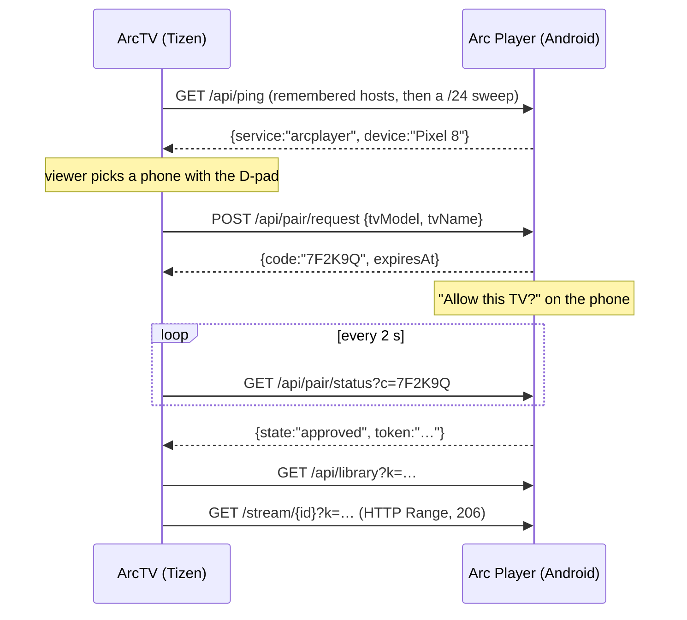

<div align="center">

# ArcTV

**Your Arc Player library, on the television.**

A Tizen web app for Samsung TVs that streams films straight off your phone over the LAN —
no cloud, no relay, no account. The phone is a headless HTTP server; the TV does the decoding.


</div>

---

## Why this exists

Arc Player already keeps a Telegram library on the phone and plays it beautifully there. Watching
it on a TV meant either re-uploading everything to a service or leaving the phone idle next to the
sofa. ArcTV is the third option: the phone answers HTTP on the living-room Wi-Fi, and the TV talks
to it directly. Nothing leaves the network, and the bytes go to the decoder without a transcode
step in between.

Two halves, one contract:

| Half | What it is | Where it lives |
|---|---|---|
| **TV** | Tizen 6.0 web app — ES5, no framework, ~50 KB | this repository, `tizen/` |
| **Phone** | LAN HTTP server inside Arc Player, backed by TDLib | [Arc Player](https://github.com/aesw0x/arcplayer) |

## How it works

A Tizen web app has no mDNS and no UDP, so the TV cannot announce itself or listen for a beacon.
Discovery is an HTTP scan, and access is a prompt on the phone — the TV never reads your library
until you press Allow.



The token is stored in `localStorage` and every later launch goes straight to the shelf.
[`docs/PROTOCOL.md`](docs/PROTOCOL.md) is the source of truth for the wire format.

## What it looks like

| Title page | Player |
|---|---|
|  |  |

The whole interface is drawn on a fixed **1920×1080 canvas** that `js/fit.js` scales to the window,
so a browser preview is pixel-identical to the panel at its native size. The D-pad moves between the
hero's buttons and the posters: left/right scrolls the rail, up/down crosses between them, and
scrolling is computed by hand because `scrollIntoView` also drags every ancestor with
`overflow: hidden` — including the rail's heading.

## The interesting constraints

Building for a 2021 Samsung is a trip back to a browser that shipped in 2020 inside a device that
will not let you attach a debugger.

- **ES5 only.** Chromium M76 with no build step: no optional chaining, no `??`, no arrow functions,
  no `Array.prototype.includes`. Plain `<script>` tags, loaded in order.
- **No CSS `filter`, anywhere.** On this platform a full-screen filter is software-composited, and
  one of them turns every keypress into seconds of lag. Depth is faked with translucent overlays.
- **No `aspect-ratio`, no `gap`, no `backdrop-filter`.** Geometry is spelled out in pixels.
- **4K only through AVPlay.** Media Source Extensions cap at 1080p, so the real path is the
  `<object type="application/avplayer">` surface plus `webapis.avplay`. In a browser the same
  controls drive a plain `<video>` instead, which is how this app gets developed at all.
- **DTS is not supported** by the TV's decoder, so a DTS copy needs the phone to convert it to AC-3.
- **No debugging channel.** A TV in developer mode blocks `sdb shell`, so there is no `dlog`, no
  reachable devtools socket and no way to inject keys from a PC. `js/perf.js` exists because
  measuring input-to-paint latency meant POSTing it to another machine.

## Requirements

- A Samsung TV on Tizen 6.0 or later (2021 Crystal UHD and up), in developer mode.
- Arc Player on a phone on the same Wi-Fi, with the film already downloaded.

## Quick start

The TV app can be built and driven entirely from a browser, because a protocol-complete mock phone
stands in for the Android half.

```powershell
# 1. a fake phone on :8080 — renders a test film once, then serves it with real Range support
cd tools\mock-server
powershell -ExecutionPolicy Bypass -File .\make-media.ps1
node server.js

# 2. the TV app on :8081
node tools\static.js 8081 tizen
```

Open `http://localhost:8081/?host=127.0.0.1`. `host` points the app at the mock and skips the LAN
sweep; `?subnet=192.168.0.` forces a particular prefix. The mock prints a fresh token on start-up
and prints a `/pair?c=CODE` URL when the TV asks for permission — open it, press Allow, and the
shelf loads. Set `TOKEN=…` to keep one token across runs.

## Building the package

```powershell
tizen-sdk build-project --project .\tizen --build-type Debug
```

Writes `tizen\Debug\tizen.wgt` (~50 KB) containing only the files listed in
`tizen/tizen_web_project.yaml`.

The package id in `config.xml` must be **exactly ten alphanumeric characters** (`ArcTVTizen`).
Tizen reports anything shorter as a parse failure at install time —
`install failed[118, -19], reason: Parsing error` — which reads like a signing problem and is not
one.

## Sideloading

Put the TV in developer mode with your machine's address in its host list, then power-cycle it.
Until you do, `sdb` connects and is dropped immediately.

```powershell
sdb connect <tv-address>:26101
tizen-sdk install-app --package .\tizen\Debug\tizen.wgt --serial <tv-address>:26101
tizen-sdk certificate-manager --action acquire-duid --serial <tv-address>:26101
```

The SDK's default developer certificate is accepted by a TV in developer mode, so no Samsung
account is needed to sideload. A Samsung certificate — author plus distributor carrying the TV's
DUID — is only required for store submission, which this app does not seek.

If `install-app --run` reports `App launch failed`, it missed the launch handshake; start the app
with the SDK's own CLI instead:

```powershell
<tizen-sdk>\tools\ide\bin\tizen.bat run -p ArcTVTizen.ArcTV -s <tv-address>:26101
```

## Layout

```
tizen/                 the TV app
  index.html           one page, three screens, one player layer
  css/app.css          1920x1080 geometry, no filters
  js/
    api.js             discovery, tokens, transport
    fit.js             scales the stage to the panel
    focus.js           the D-pad focus engine
    pairing.js         device list and the approval wait
    library.js         hero + poster rail
    detail.js          a film's page
    player.js          AVPlay, with a <video> fallback
    app.js             screen routing and state
    perf.js            latency diagnostics, inert unless asked for
tools/
  mock-server/         protocol-complete fake phone
  static.js            serves tizen/ over http
  telemetry-server.js  collects what perf.js reports
docs/
  PROTOCOL.md          the wire contract — read this first
  IMPLEMENTATION_PLAN.md
  PHONE-SIDE.md        how the server on the phone is built
  M1-VALIDATION.md     curl + VLC checks for it
  ui/                  screenshots
```

## Status

- [x] Discovery, device list, phone-approved pairing
- [x] Library — featured hero, poster rail, D-pad focus engine
- [x] Player — AVPlay on the panel, `<video>` in a browser, full transport controls
- [ ] Audio track and subtitle selection, bitrate warning — written, and proven in a browser;
      the panel has not been reachable since, so nothing has been seen on the TV itself
- [ ] Hardening: reconnects, partial files, hostile payloads
- [x] Packaged and sideloaded (`ArcTVTizen.ArcTV`)
- [x] Phone: `/api/progress` and `/api/subtitles` — both routes exist on the phone and were
      checked with curl against a debug build on 2026-11-03
- [x] Phone: unsupported audio detected by file name (`audioCodec`, `needsRemux`) and warned about
- [ ] Phone: DTS / TrueHD → AC-3 conversion. Nothing converts; §9 of `docs/PROTOCOL.md`

## Licence

Apache License 2.0 — see [LICENSE](LICENSE). Personal project; not affiliated with Samsung, and not
intended for the Tizen store.
